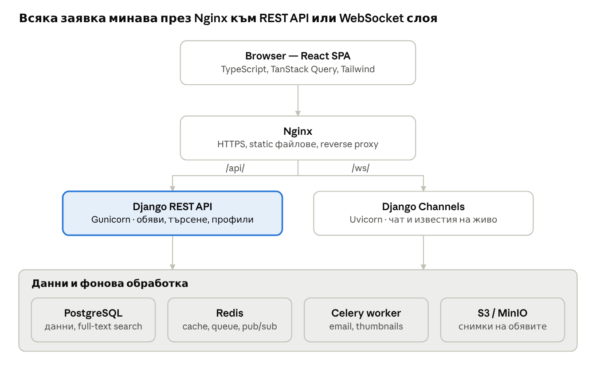

# Marketplace за учебници втора употреба — анализ и план

Nov 9, 2026 · @Atanas

## Визия и обхват

Приложението свързва студенти и ученици, които продават използвани учебници, с такива, които търсят по-евтини копия. Проектът се строи в 8 етапа, като първо излиза работещ MVP, а след това се добавят real-time чат, известия и deployment в cloud.

**Проблемът:** новите учебници са скъпи, а старите стоят неизползвани. Обявите са разпръснати във Facebook групи и OLX, без търсене по ISBN, предмет или курс.

**Потребители (роли):**

| Роля              | Какво прави                                                         | Нужен ли е акаунт       |
|-------------------|---------------------------------------------------------------------|-------------------------|
| Гост              | Разглежда и търси обяви                                             | Не                      |
| Потребител        | Публикува обяви, пише на продавачи, оставя отзиви                   | Да                      |
| Модератор / Admin | Преглежда сигнали, блокира обяви и потребители, управлява категории | Да, със специални права |

**Обхват на MVP (задължително):**

- Регистрация, вход, потвърждение на email, профил

- CRUD на обяви със снимки

- Търсене и филтри (заглавие, автор, ISBN, предмет, състояние, цена, град)

- Любими обяви

- Съобщения между купувач и продавач (първо обикновени, после real-time)

- Маркиране на обява като продадена

- Admin панел

**След MVP (nice to have):**

- Real-time чат с WebSockets и известия

- Отзиви и рейтинг на продавачи

- Автоматично попълване на данни по ISBN (Open Library / Google Books API)

- Запазени търсения с известие при нова обява

- Сигнали за неподходящи обяви

**Извън обхвата:** онлайн плащания и доставка. Сделката се урежда между хората, което маха нуждата от платежен доставчик и правни въпроси.

## Функционални изисквания и user stories

Изискванията са групирани по модули; всеки модул става отделно Django app. Приоритетите следват MoSCoW: Must = MVP, Should = след MVP, Could = ако остане време.

| Модул          | User story                                                                          | Приоритет |
|----------------|-------------------------------------------------------------------------------------|-----------|
| Accounts       | Като гост искам да се регистрирам с email и парола, за да публикувам обяви          | Must      |
| Accounts       | Като потребител искам да потвърдя email-а си, за да се доказва, че съм реален човек | Must      |
| Accounts       | Като потребител искам да сменя или възстановя паролата си                           | Must      |
| Accounts       | Като потребител искам профил с име, град, снимка и мои обяви                        | Must      |
| Listings       | Като продавач искам да създам обява с до 5 снимки, цена, състояние и описание       | Must      |
| Listings       | Като продавач искам да редактирам, скрия или маркирам обява като продадена          | Must      |
| Listings       | Като продавач искам при въвеждане на ISBN полетата да се попълват автоматично       | Should    |
| Catalog        | Като купувач искам да търся по заглавие, автор или ISBN                             | Must      |
| Catalog        | Като купувач искам да филтрирам по предмет, клас/курс, състояние, цена и град       | Must      |
| Catalog        | Като купувач искам резултатите да се сортират по цена, дата или релевантност        | Must      |
| Favorites      | Като купувач искам да запазвам обяви в любими                                       | Must      |
| Messaging      | Като купувач искам да пиша на продавача по конкретна обява                          | Must      |
| Messaging      | Като потребител искам да получавам съобщенията в реално време                       | Should    |
| Notifications  | Като потребител искам известие за ново съобщение (в приложението и по email)        | Should    |
| Reviews        | Като купувач искам да оставя оценка на продавача след сделка                        | Should    |
| Moderation     | Като потребител искам да подам сигнал за неподходяща обява                          | Should    |
| Moderation     | Като admin искам да преглеждам сигнали и да блокирам обяви или потребители          | Must      |
| Saved searches | Като купувач искам известие, когато се появи обява по запазено търсене              | Could     |

**Бизнес правила, които трябва да се спазват в кода:**

- Само собственикът на обява може да я редактира или изтрива.

- Продавач не може да пише сам на себе си и не може да оценява сам себе си.

- Отзив може да се остави само веднъж на разговор и само от участник в него.

- Продадена обява остава видима 7 дни с етикет „Продадена“, после се скрива от търсенето.

- Изтриването на обява е soft delete, за да не се губи историята на разговорите.

## Нефункционални изисквания

Това е частта, която отличава „учебен проект“ от „проект като в production“, и интервюиращите питат точно за нея.

| Област               | Изискване                                        | Как се постига                                                                      |
|----------------------|--------------------------------------------------|-------------------------------------------------------------------------------------|
| Сигурност            | Пароли само като hash                            | Django PBKDF2 / Argon2 hasher                                                       |
| Сигурност            | Защита от brute force при вход                   | Rate limiting (DRF throttling или django-axes)                                      |
| Сигурност            | Автентикация на API                              | JWT (djangorestframework-simplejwt), access token кратък, refresh в httpOnly cookie |
| Сигурност            | Права на достъп                                  | Custom DRF permissions (IsOwnerOrReadOnly) + тестове за тях                         |
| Сигурност            | Безопасно качване на файлове                     | Проверка на тип и размер (до 5 MB), преоразмеряване, премахване на EXIF данни       |
| Сигурност            | Тайни извън кода                                 | .env файлове, django-environ, нищо чувствително в Git                               |
| Сигурност            | XSS, CSRF, SQL injection                         | ORM вместо raw SQL, escaping във frontend, CORS само за собствения домейн           |
| Производителност     | Списъкът с обяви се зарежда под 300 ms           | Pagination, индекси, select_related / prefetch_related срещу N+1 заявки             |
| Производителност     | Бързо търсене                                    | PostgreSQL full-text search с GIN индекс и pg_trgm за грешно изписани думи          |
| Производителност     | Снимки                                           | Thumbnails при качване, отделно хранилище (S3-compatible), не в базата              |
| Надеждност           | Тежки задачи не блокират заявката                | Celery + Redis за email-и, обработка на снимки, известия                            |
| Качество             | Тестово покритие над 80% за backend              | pytest, pytest-django, factory_boy, coverage                                        |
| Качество             | Единен стил на кода                              | ruff, black, pre-commit; ESLint + Prettier за frontend                              |
| Наблюдаемост         | Грешките се виждат                               | Structured logging + Sentry (безплатен план)                                        |
| Достъпност и UX      | Работи на телефон                                | Mobile-first дизайн, семантичен HTML, контраст по WCAG AA                           |
| Поверителност (GDPR) | Потребителят може да изтрие акаунта и данните си | Endpoint за изтриване и анонимизиране, Privacy Policy страница                      |

## Технологичен стек

Изборът е Django REST Framework + PostgreSQL за backend и React + TypeScript за frontend: зрял, търсен на пазара в България стек, в който всяка нужда от изискванията има утвърдено решение.

| Слой             | Технология                                                                                     | Защо                                                                                              |
|------------------|------------------------------------------------------------------------------------------------|---------------------------------------------------------------------------------------------------|
| Backend          | Python 3.12, Django 5, Django REST Framework                                                   | Вграден ORM, admin панел, автентикация и миграции; DRF дава serializers, permissions и pagination |
| База данни       | PostgreSQL 16                                                                                  | Full-text search, pg_trgm, JSON полета, транзакции                                                |
| Real-time        | Django Channels + Redis                                                                        | WebSockets за чата и известията без отделен сървър на друг език                                   |
| Фонови задачи    | Celery + Redis                                                                                 | Email-и, thumbnails, известия за запазени търсения                                                |
| Файлове          | S3-compatible storage (MinIO локално, Cloudflare R2 или AWS S3 в production) + django-storages | Снимките не тежат на сървъра и базата                                                             |
| API документация | drf-spectacular (OpenAPI 3 + Swagger UI)                                                       | Документацията се генерира от кода и не остарява                                                  |
| Frontend         | React 18 + TypeScript + Vite                                                                   | Типизиран код, бърз dev server, най-търсената frontend библиотека                                 |
| Data fetching    | TanStack Query + Axios                                                                         | Кеширане, retry и pagination без ръчно управление на state                                        |
| Форми            | React Hook Form + Zod                                                                          | Валидация с типове, споделени със схемата                                                         |
| UI               | Tailwind CSS (+ shadcn/ui компоненти)                                                          | Бърз, консистентен и responsive дизайн                                                            |
| Тестове          | pytest, factory_boy; Vitest + React Testing Library; Playwright за E2E                         | Покриват unit, integration и цели потребителски сценарии                                          |
| Инфраструктура   | Docker, Docker Compose, Nginx, Gunicorn / Uvicorn                                              | Еднаква среда локално и в production                                                              |
| CI/CD            | GitHub Actions                                                                                 | Lint, тестове и deploy при всеки push                                                             |
| Hosting          | VPS (Hetzner, DigitalOcean) или Render / Railway                                               | Евтин старт; VPS показва повече DevOps умения                                                     |
| Мониторинг       | Sentry, health-check endpoint, UptimeRobot                                                     | Знаеш за проблем преди потребителите                                                              |

**Алтернатива с по-малко части:** Django templates + HTMX вместо React. Проектът става по-бърз за правене, но показва по-малко frontend умения. Ако целта е full-stack позиция, React е по-добрият избор.

## Архитектура и модел на данните

Архитектурата е модулен монолит: един Django проект, разделен на apps (accounts, listings, catalog, messaging, notifications, reviews, moderation), плюс отделен React frontend. За този мащаб това е по-правилно от microservices и е лесно за обяснение на интервю.



Nginx разпределя трафика: обикновените заявки отиват към REST API, а WebSocket връзките към Channels. Тежката работа (email-и, обработка на снимки) се изпраща към Celery чрез Redis, за да не бави отговора.

**Модел на данните**

| Модел        | Основни полета                                                                        | Връзки и ограничения                                                                                                    |
|--------------|---------------------------------------------------------------------------------------|-------------------------------------------------------------------------------------------------------------------------|
| User         | email, password, is_verified, date_joined                                             | Custom модел, email е unique                                                                                            |
| Profile      | display_name, city, avatar, rating_avg                                                | 1:1 с User                                                                                                              |
| Subject      | name, slug                                                                            | Справочник (Математика, История…)                                                                                       |
| City         | name                                                                                  | Справочник                                                                                                              |
| Book         | isbn, title, author, publisher, year, grade                                           | FK към Subject; isbn е unique, но nullable (стари учебници нямат ISBN)                                                  |
| Listing      | price, condition, description, status, created_at, sold_at, is_deleted, search_vector | FK към User (продавач), Book, City; condition и status са TextChoices; GIN индекс върху search_vector; CHECK price > 0 |
| ListingImage | image, thumbnail, order                                                               | FK към Listing, максимум 5 на обява                                                                                     |
| Favorite     | created_at                                                                            | FK към User и Listing; unique (user, listing)                                                                           |
| Conversation | created_at, updated_at                                                                | FK към Listing, buyer и seller; unique (listing, buyer)                                                                 |
| Message      | body, created_at, read_at                                                             | FK към Conversation и sender; индекс по (conversation, created_at)                                                      |
| Notification | type, payload (JSON), is_read                                                         | FK към User                                                                                                             |
| Review       | rating (1–5), comment                                                                 | FK към reviewer и reviewee; unique към Conversation                                                                     |
| Report       | reason, status, resolved_by                                                           | FK към reporter и Listing                                                                                               |

Book е отделен от Listing нарочно: много обяви сочат към една и съща книга, което позволява търсене по ISBN, статистика за цени и бъдеща функция „уведоми ме, когато се появи този учебник“.

## API дизайн

API-то е REST, версионирано под /api/v1/, с JSON отговори, cursor или page pagination и еднакъв формат на грешките. Пълната документация се генерира автоматично в /api/docs/.

| Метод              | Endpoint                                                                       | Описание                                       | Достъп                      |
|--------------------|--------------------------------------------------------------------------------|------------------------------------------------|-----------------------------|
| POST               | /auth/register/                                                                | Регистрация                                    | Публичен                    |
| POST               | /auth/verify-email/                                                            | Потвърждение с token от email                  | Публичен                    |
| POST               | /auth/token/                                                                   | Вход, връща access + refresh token             | Публичен                    |
| POST               | /auth/token/refresh/                                                           | Нов access token                               | Публичен (с refresh cookie) |
| POST               | /auth/password-reset/                                                          | Заявка за нова парола                          | Публичен                    |
| GET, PATCH, DELETE | /users/me/                                                                     | Собствен профил, редакция, изтриване на акаунт | Влязъл                      |
| GET                | /users/{id}/                                                                   | Публичен профил с обяви и рейтинг              | Публичен                    |
| GET                | /listings/?q=&subject=&grade=&condition=&city=&min_price=&max_price=&ordering= | Търсене и филтри                               | Публичен                    |
| POST               | /listings/                                                                     | Нова обява                                     | Влязъл                      |
| GET, PATCH, DELETE | /listings/{id}/                                                                | Детайли, редакция, soft delete                 | Публичен / собственик       |
| POST               | /listings/{id}/mark-sold/                                                      | Маркира като продадена                         | Собственик                  |
| POST, DELETE       | /listings/{id}/images/                                                         | Качване и премахване на снимки                 | Собственик                  |
| GET                | /books/lookup/?isbn=                                                           | Данни за книга по ISBN                         | Влязъл                      |
| GET                | /subjects/, /cities/                                                           | Справочни списъци за филтрите                  | Публичен                    |
| GET, POST, DELETE  | /favorites/                                                                    | Любими обяви                                   | Влязъл                      |
| GET, POST          | /conversations/                                                                | Мои разговори, започване на разговор по обява  | Влязъл                      |
| GET, POST          | /conversations/{id}/messages/                                                  | Съобщения в разговор                           | Участник                    |
| WS                 | /ws/chat/{conversation_id}/                                                    | Real-time канал за чата                        | Участник                    |
| GET, PATCH         | /notifications/                                                                | Известия, маркиране като прочетени             | Влязъл                      |
| POST               | /reviews/                                                                      | Отзив за продавач                              | Участник в разговор         |
| POST               | /reports/                                                                      | Сигнал за обява                                | Влязъл                      |

**Формат на грешка (еднакъв навсякъде):**

```json
{
  "error": {
    "code": "validation_error",
    "message": "Невалидни данни",
    "fields": { "price": ["Цената трябва да е положително число."] }
  }
}
```

**Правила:** HTTP кодовете се ползват по предназначение (201 при създаване, 204 при изтриване, 403 при липса на права, 404 за чужди скрити ресурси), а всички списъци имат pagination по подразбиране с максимум 50 резултата.

## Етапи на реализация

Проектът минава през 8 етапа за около 16 седмици при 10–12 часа работа седмично. Всеки етап завършва с работещ, тестван и merge-нат в main резултат; не се започва следващ, преди текущият да покрие своя Definition of Done.

### Етап 0 — Подготовка и дизайн (1 седмица)

Цел: ясна представа какво се строи, преди да се напише ред код.

- [ ] GitHub repository (monorepo: backend/, frontend/, infra/), лиценз, .gitignore

- [ ] GitHub Projects board с issues за всяка user story от таблицата горе

- [ ] ERD на базата данни (dbdiagram.io) и запис в docs/

- [ ] Wireframes на 6-те основни екрана във Figma или на хартия: начало/търсене, обява, създаване на обява, профил, разговори, вход

- [ ] Първи ADR (Architecture Decision Record) за избора на стек

**Definition of Done:** има backlog, ERD и wireframes в repo-то.

### Етап 1 — Основа на проекта и инфраструктура (1 седмица)

Цел: празен, но професионално настроен проект, който се стартира с една команда.

- [ ] Django проект с разделени settings (base, dev, prod) и django-environ

- [ ] Vite + React + TypeScript проект

- [ ] docker-compose.yml: backend, frontend, PostgreSQL, Redis, MinIO

- [ ] pre-commit с ruff, black, ESLint, Prettier

- [ ] GitHub Actions: lint + тестове при всеки pull request

- [ ] /api/health/ endpoint и drf-spectacular документация

- [ ] README с инструкции за стартиране

**Definition of Done:** docker compose up вдига всичко, CI е зелен.

### Етап 2 — Потребители и автентикация (2 седмици)

- [ ] Custom User модел от първия ден (email вместо username), Profile

- [ ] Регистрация, потвърждение на email (Celery task), вход с JWT, refresh, logout

- [ ] Смяна и възстановяване на парола

- [ ] Rate limiting на auth endpoints

- [ ] Frontend: страници за вход и регистрация, защитени routes, auth context

- [ ] Тестове за всички auth сценарии, включително грешните

**Definition of Done:** потребител минава целия път регистрация → email → вход → профил, покритие над 80%.

### Етап 3 — Обяви и снимки (3 седмици)

- [ ] Модели Book, Listing, ListingImage, Subject, City + миграции и seed данни

- [ ] CRUD API с permissions за собственик, soft delete, mark-sold

- [ ] Качване на снимки в S3-compatible storage, валидация, thumbnails в Celery

- [ ] Попълване по ISBN чрез Open Library API (с кеширане в Redis)

- [ ] Frontend: форма за обява (multi-step), страница на обява, „Мои обяви“

- [ ] Django admin, настроен за модерация

**Definition of Done:** обява се създава, редактира и продава от UI; чужд потребител получава 403 при опит за редакция (има тест).

### Етап 4 — Търсене, филтри и любими (2 седмици)

- [ ] PostgreSQL full-text search (SearchVector, SearchRank) с GIN индекс

- [ ] pg_trgm за толерантност към грешки при изписване

- [ ] django-filter за филтрите, сортиране, pagination

- [ ] Любими обяви

- [ ] Frontend: търсачка, панел с филтри, синхронизиран с URL (за споделяне на търсене), infinite scroll

- [ ] Проверка на заявките с django-debug-toolbar за N+1 проблеми

**Definition of Done:** търсене по част от заглавие с грешка в буква намира книгата; списъкът прави фиксиран брой SQL заявки.

### Етап 5 — Съобщения и real-time чат (2–3 седмици)

- [ ] Модели Conversation, Message; REST API за история

- [ ] Django Channels + Redis channel layer, автентикация на WebSocket с JWT

- [ ] Индикатор за непрочетени съобщения

- [ ] Модел Notification + email известие, ако потребителят не е онлайн

- [ ] Frontend: списък с разговори, чат прозорец, reconnect при загуба на връзка

- [ ] Тестове за consumers (channels.testing)

**Definition of Done:** двама потребители в различни браузъри си пишат в реално време; трети потребител не може да чете разговора им.

### Етап 6 — Отзиви, модерация и завършване на продукта (2 седмици)

- [ ] Отзиви и среден рейтинг на продавача

- [ ] Сигнали за обяви и работен процес за модератор

- [ ] Изтриване на акаунт (GDPR), Privacy Policy и Terms

- [ ] Празни състояния, loading skeletons, страници за грешки, responsive проверка

- [ ] E2E тестове с Playwright за 3–4 ключови сценария

**Definition of Done:** всички Must и Should истории са готови; E2E тестовете минават в CI.

### Етап 7 — Production deployment (1–2 седмици)

- [ ] Production Dockerfiles (multi-stage build), Gunicorn/Uvicorn + Nginx

- [ ] VPS или PaaS, домейн, HTTPS (Let's Encrypt)

- [ ] CD в GitHub Actions: build на images, push в registry, deploy при merge в main

- [ ] Автоматичен backup на базата

- [ ] Sentry, логове, UptimeRobot

- [ ] Seed с реалистични демо данни и демо акаунт за работодатели

**Definition of Done:** приложението е публично достъпно на собствен домейн, deploy-ът е автоматичен.

### Етап 8 — Представяне (1 седмица)

- [ ] README с описание, screenshots, GIF демо, архитектурна диаграма, линк към live версията

- [ ] Секция „Технически решения и компромиси“ (полезна за интервю)

- [ ] Кратко видео (2–3 мин) с демонстрация

- [ ] Pin на repo-то в GitHub профила и описание в CV и LinkedIn

## Работен процес

Дори при работа сам, процесът трябва да изглежда като в екип: работодателят ще разгледа историята в GitHub, не само крайния код.

**Git и pull requests**

- Branching: GitHub Flow — main е винаги работещ, всяка задача е в собствен branch (feature/listing-crud, fix/login-throttle).

- Commit съобщения по Conventional Commits: feat(listings): add mark-sold endpoint, fix(auth): handle expired refresh token.

- Всяка промяна влиза през pull request, свързан с issue (Closes #12), с кратко описание и screenshots при UI промени.

- main е защитен: merge само при зелен CI.

**Тестова стратегия**

| Ниво        | Какво се тества                                              | Инструмент                                     |
|-------------|--------------------------------------------------------------|------------------------------------------------|
| Unit        | Модели, serializers, бизнес правила, помощни функции         | pytest, Vitest                                 |
| Integration | API endpoints с база данни, permissions, WebSocket consumers | pytest-django, DRF APIClient, channels.testing |
| Component   | React компоненти и форми                                     | React Testing Library                          |
| E2E         | Регистрация → обява → търсене → съобщение                    | Playwright                                     |

Правило: всеки bug получава тест, който го възпроизвежда, преди да бъде поправен.

**CI/CD pipeline (GitHub Actions)**

1.  При pull request: lint (backend и frontend), type check (mypy, tsc), тестове с PostgreSQL и Redis service containers, coverage отчет.

2.  При merge в main: build на Docker images, push в GitHub Container Registry.

3.  Deploy на сървъра, миграции, smoke test на /api/health/.

**Документация в repo-то**

- README.md — какво е, как се стартира, линк към demo

- docs/architecture.md — диаграма и описание на компонентите

- docs/adr/ — записи за важните технически решения

- CONTRIBUTING.md и .env.example

- OpenAPI документация, генерирана от кода

## Рискове и следващи стъпки

Най-големият риск при личен проект не е технически, а че обхватът расте и проектът остава недовършен. Затова MVP-то е строго ограничено, а всичко останало чака.

| Риск                                 | Последица                              | Как се избягва                                                                  |
|--------------------------------------|----------------------------------------|---------------------------------------------------------------------------------|
| Разрастване на обхвата               | Проектът никога не стига до production | Само Must истории до края на Етап 4; нови идеи отиват в backlog                 |
| Real-time чатът е най-сложната част  | Блокира напредъка седмици наред        | Първо REST съобщения, WebSockets се добавят върху работещ модел                 |
| Ново за теб: Channels, Celery, S3    | Бавен старт, грешна архитектура        | Малък отделен прототип (spike) от 1–2 дни преди всяка нова технология           |
| Липса на време (университет, изпити) | Дълги паузи, загуба на контекст        | Малки issues (до 3 часа), кратка бележка „докъде стигнах“ в края на всяка сесия |
| Разходи за hosting                   | Месечни такси                          | VPS за около 5 €/месец или безплатни планове; R2 има безплатен лимит за снимки  |
| Злоупотреби (спам, фалшиви обяви)    | Лош вид на live демото                 | Потвърден email за публикуване, rate limiting, модерация                        |

**Първи стъпки тази седмица:**

- [ ] Създай repository и GitHub Projects board

- [ ] Нарисувай ERD по модела в този документ

- [ ] Направи wireframes на началната страница и страницата на обява

- [ ] Подготви docker-compose.yml с PostgreSQL и празен Django проект
